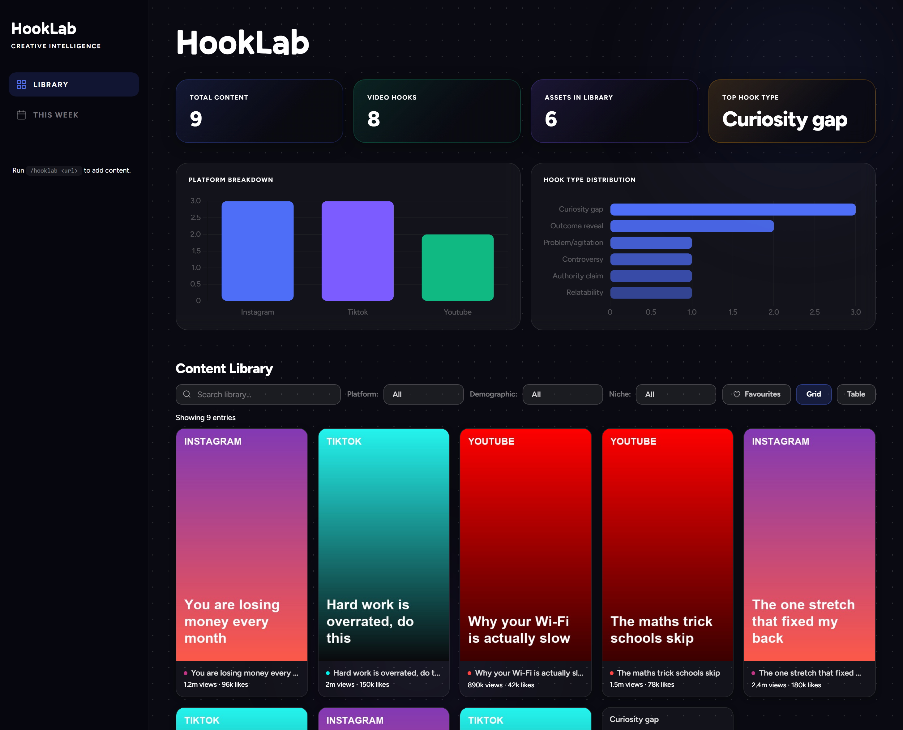

# HookLab

**See what makes a short-form hook work, right inside Claude Code.**

[](https://github.com/CoolerGit/HookLab/actions/workflows/ci.yml)




A suite of [Claude Code](https://claude.ai/code) skills for analysing short-form videos. Point it at a TikTok, Instagram Reel, or YouTube Short (or an image or a piece of copy) and Claude scores the hook against a binary checklist, classifies the target demographic and niche, extracts the retention tactics, and saves reusable creative assets into a searchable library with a dashboard.

HookLab runs **inside Claude Code**. The analysis is done by Claude directly, chat-natively, so there is no separate AI API to sign up for or pay for. The small Python scripts in this repo are helpers the skills call to fetch content and store results; they are not meant to be run as a standalone product.

## The skills

| Skill | What it does |
|---|---|
| `/hooklab <url / image / text>` | Ingest one piece of content, score its hook, and save it to the library. Give it nothing and it explains HookLab instead. |
| `/hooklab-scriptgen` | Compose a new short-form script engineered from your existing library, with every choice sourced. |
| `/hooklab-dashboard` | Open the visual analytics dashboard in the browser. |
| `/hooklab-seo` | Generate an SEO title, description/caption, and tags for a video. |
| `/hooklab-edit` | Turn a raw clip into a finished 9:16 short. |

## Why HookLab

- **The hard part is the analysis, and Claude does it.** No model API to wire up or pay for: hook typing, checklist scoring, demographic and niche classification, and asset extraction all happen inside Claude Code.
- **It builds a library you can reuse.** Every ingest adds scored hooks and reusable creative assets, so `/hooklab-scriptgen` can engineer new scripts from what has actually worked for you.
- **It is honest about what works.** Binary checklists instead of vibes, with a 50% pass-rate bar before a hook counts as a reference worth building from.

## How it works

1. `/hooklab` calls `ingest.py --fetch-only` to pull a URL's transcript, thumbnail, and stats via [Apify](https://apify.com) actors.
2. **Claude** reads the thumbnail and transcript and does the analysis itself: hook type, checklist scoring, demographic and niche, retention tactics, and reusable assets. No external analysis API is involved.
3. `ingest.py --save-result` writes the result to a local SQLite database (`hooks.db`, created automatically on first run).
4. `/hooklab-dashboard` serves a Flask dashboard (`server.py` + `dashboard.html`) over your library.

## Checklists

- **Video (7 items):** outcome before how, on-screen text in the first 2 seconds, audio suspense/mid-thought cut, human face or reaction, two or more layers aligned to one mechanism, pattern interrupt in the first second, no intro before value.
- **Image (5 items):** clear single focal point, text readable without zooming, contrast-driven colour palette, recognisable aesthetic, creates an unresolved question or desire.
- **Text/Copy (5 items):** unqualified claim in the first sentence, addresses a specific person or situation, creates an information gap, opening under 10 words, concrete not abstract language.

## Requirements and cost

- [Claude Code](https://claude.ai/code) (HookLab is a set of Claude Code skills).
- Python 3.10+ (the skills call small Python helper scripts).
- An [Apify](https://console.apify.com) account and token, set as the `APIFY_TOKEN` environment variable. Apify is a paid scraping service and its actors cost credits per run, so factor that in before bulk-ingesting. **This is the only external service HookLab needs**, the hook analysis itself is done by Claude, not a paid API.

## Setup

```powershell
pip install -r requirements.txt

# Set your Apify token as an environment variable (never hardcode it). On Windows:
setx APIFY_TOKEN "apify_api_..."
# then restart your terminal
```

See `.env.example`. Then open this folder in Claude Code and use the skills above.

`hooks.db` and `thumbnails/` are created locally on first run and are gitignored; they hold your own ingested content and stay on your machine.

## Structure

| Path | Role |
|---|---|
| `.claude/skills/` | The Claude Code skills (the actual product) |
| `ingest.py` | Fetch (Apify) + save (SQLite) helper that `/hooklab` calls |
| `server.py` / `dashboard.html` | Flask dashboard |
| `db_export.py` | Read-only JSON export of the library, used by `/hooklab-scriptgen` |
| `library.py` | Shared helpers: DB loaders, pass-rate, pip bootstrap |

## Contributing

See [CONTRIBUTING.md](CONTRIBUTING.md) and [CODE_OF_CONDUCT.md](CODE_OF_CONDUCT.md).

## License

[Apache-2.0](LICENSE). The bundled Pally font is under the Fontshare / ITF Free Font License; see [NOTICE](NOTICE).
